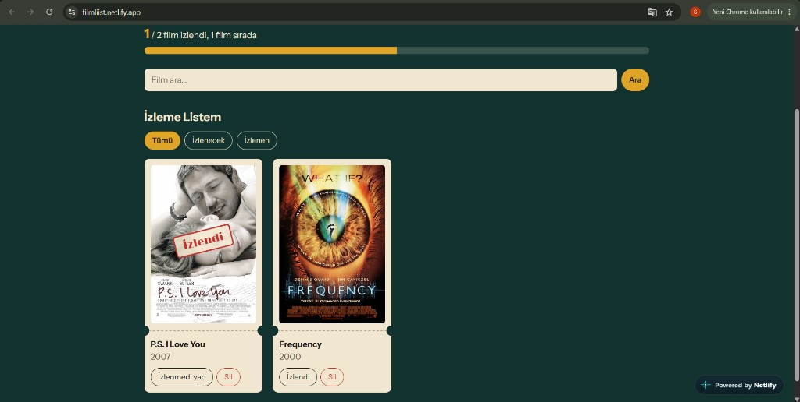

# Film İzleme Listesi

React ve Vite ile yapılmış bir film izleme listesi. OMDb üzerinden film aranır; seçilen filmler listeye eklenir, izlendi olarak işaretlenir veya silinir.

**Canlı site:** https://filmliist.netlify.app/

## Ekran görüntüsü



## Özellikler

- OMDb API film arama
- Listeye ekleme
- İzleme listesini görüntüleme (tümü, izlenecek, izlenen)
- İzlendi durumunu güncelleme
- Listeden silme
- Toplam, izlenen ve izlenecek sayıları
- Listenin tarayıcıda `localStorage` ile saklanması

Sayfa kapanıp açılsa da izleme listesi durur. Arama sonuçları kaydedilmez.

## Teknolojiler

- React
- Vite
- Düz CSS
- [OMDb API](https://www.omdbapi.com/)

## Proje yapısı

- `components/`: arayüz bileşenleri
- `hooks/`: izleme listesi mantığı
- `utils/`: API ve LocalStorage yardımcıları

## Kurulum

Node.js kurulu olmalı.

```bash
npm install
```

Proje klasöründe `.env` dosyası oluştur ve OMDb anahtarını yaz:

```bash
VITE_OMDB_KEY=anahtarın
```

Ücretsiz anahtar için [omdbapi.com/apikey.aspx](https://www.omdbapi.com/apikey.aspx) adresinden kayıt olunur.

Geliştirme sunucusunu başlat:

```bash
npm run dev
```

Uygulama `http://localhost:5173` adresinde açılır.

## Veriler nerede duruyor

İzleme listesi sunucuya gitmez. Tarayıcıda `movie-watchlist` anahtarıyla saklanır. Başka bir tarayıcıda veya site verileri silinince liste boş görünür.
